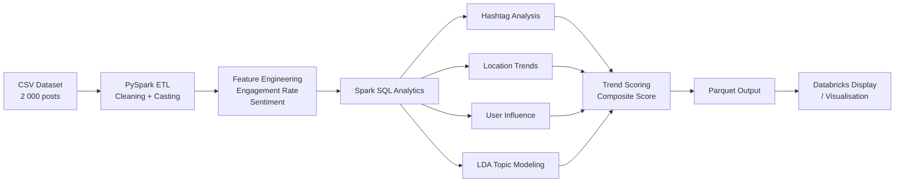

# Social Media Trend Analysis using PySpark 🚀

Analyse social media posts to uncover trending hashtags, engagement patterns, user sentiment, and influencer scores using PySpark, NLP, and Spark SQL.

---

## 🧠 Project Overview

A Big Data analytics pipeline that processes a synthetic but realistic social media dataset to produce actionable insights. Demonstrates core data engineering skills: ETL, SQL analytics, NLP, and visualisation.

### Key Features

| Feature | Description |
|---|---|
| 📈 Trending Analysis | Top performing hashtags ranked by frequency |
| ❤️ Engagement Metrics | Likes, shares, comments + normalised engagement rate |
| 😊 Sentiment Classification | TextBlob NLP (Positive / Negative / Neutral) |
| 🧹 Data Cleaning | Robust ETL handling nulls and type casting |
| 🌍 Location Trends | Dominant category per city |
| 🌟 Influencer Scoring | `log(followers) × engagement_rate` influence metric |
| 📱 Platform Breakdown | Per-platform engagement & sentiment comparison |
| 🧠 LDA Topic Modeling | 8-topic unsupervised discovery |
| 📝 Bigram Extraction | Common two-word phrase detection |
| 📊 TF-IDF Keywords | Core vs distinctive term analysis |
| 💾 Optimised Storage | Results persisted as Parquet |

---

## 🏗️ Architecture



---

## 🧰 Tech Stack

| Layer | Tools |
|---|---|
| Language | Python 3.11+ |
| Processing | Apache Spark 3.5+ (PySpark) |
| NLP | TextBlob, NLTK, Spark MLlib (TF-IDF, LDA, NGram) |
| Storage | Parquet, CSV |
| Visualisation | Databricks `display()` |
| Environment | Databricks / Google Colab / Jupyter |

---

## 📁 Project Structure

```
Social-Media-Trend-Analysis/
│
├── data/
│   └── social_media_posts.csv       # 2 000-row synthetic dataset
│
├── notebooks/
│   └── Social_Media_Trend_Analysis_NLP_Enhanced.ipynb
│
├── output/                          # Parquet results (generated at runtime)
│   ├── processed_posts/
│   ├── trending_hashtags/
│   └── trend_scores/
│
├── generate_data.py                 # Modular data generator (CLI)
├── requirements.txt                 # Python dependencies
└── README.md
```

---

## 📊 Dataset Schema

| Column | Type | Description |
|---|---|---|
| `post_id` | int | Unique post identifier |
| `user_id` | int | Anonymised user ID |
| `username` | string | Display name |
| `platform` | string | Twitter / Instagram / LinkedIn / Reddit / TikTok |
| `location` | string | City where post originated |
| `follower_count` | long | Author's follower count (power-law distribution) |
| `text` | string | Raw post text |
| `hashtags` | string | Pipe-separated hashtag tokens |
| `category` | string | Content category (8 categories) |
| `likes` | int | Likes (platform-weighted) |
| `shares` | int | Shares / retweets |
| `comments` | int | Comment count |
| `timestamp` | string | `YYYY-MM-DD HH:MM:SS` |

---

## 🚀 Getting Started

### 1. Generate Fresh Data

```bash
# Default: 2 000 posts
python3 generate_data.py

# Custom size and output path
python3 generate_data.py --num-posts 5000 --output data/big_dataset.csv
```

### 2. Install Dependencies (local)

```bash
pip install -r requirements.txt
```

### 3. Run Analysis (Databricks)

1. Upload `notebooks/Social_Media_Trend_Analysis_NLP_Enhanced.ipynb` to Databricks.
2. Upload `data/social_media_posts.csv` to a Databricks Volume.
3. Update `DATA_PATH` in Cell 4 to match your Volume path.
4. **Run All** → results appear inline; Parquet files saved to `/tmp/social_media_analysis_output/`.

### 4. Run Locally (Jupyter)

```bash
jupyter notebook notebooks/Social_Media_Trend_Analysis_NLP_Enhanced.ipynb
```
> Change `spark.read.csv(...)` to `pd.read_csv(...)` when running without a Spark cluster.

---

## 📊 Sample Insights

**Platform Engagement (avg engagement rate %):**

| Platform | Avg Rate |
|---|---|
| TikTok | ~2.8% |
| Instagram | ~1.6% |
| Reddit | ~1.1% |
| Twitter | ~0.9% |
| LinkedIn | ~0.5% |

**Top Hashtags:** `#tech`, `#fitness`, `#netflix`

**Sentiment Split:** ~60% Positive · ~25% Neutral · ~15% Negative

---

## 📝 Resume Bullet Points

- *"Built a PySpark NLP pipeline on Databricks to process 2 000+ social media posts, implementing TF-IDF, LDA topic modelling, and TextBlob sentiment analysis to surface trending topics and influencer scores."*
- *"Engineered a composite Trend Score combining log-volume, growth rate, 4-day momentum, sentiment polarity, and normalised engagement rate across 5 social media platforms."*
- *"Designed a modular data generation framework (CLI) producing realistic, platform-aware synthetic datasets with 13 feature columns and power-law follower distributions."*

---

*Created for portfolio demonstration. All data is synthetic — no real user data or internal secrets are used.*
