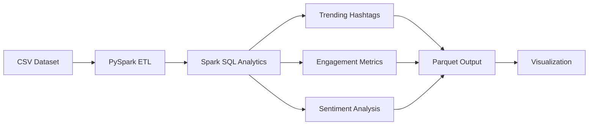

# Social Media Trend Analysis using PySpark 🚀

Analyze social media posts to uncover trending hashtags, engagement patterns, and user sentiment using PySpark and Spark SQL.

## 🧠 Project Overview

This project implements a Big Data analytics pipeline that processes simulated social media data to provide actionable insights. It demonstrates core data engineering skills including ETL, SQL analytics, and data visualization.

### Key Features
- **📈 Trending Analysis**: Identify top performing hashtags in real-time
- **❤️ Engagement Metrics**: Analyze user interaction patterns (likes, retweets)
- **😊 Sentiment Classification**: Rule-based sentiment analysis (Positive/Negative/Neutral)
- **🧹 Data Cleaning**: Robust ETL process handling missing values and data type casting
- **💾 Optimized Storage**: Results saved in efficient Parquet format

## 🏗️ Architecture



## 🧰 Tech Stack

- **Environment**: Google Colab / Local Python
- **Processing**: Apache Spark (PySpark)
- **Storage**: Parquet, CSV
- **Visualization**: Matplotlib
- **Language**: Python 3.8+

## 📁 Project Structure

```bash
Social-Media-Trend-Analysis/
│
├── data/
│   └── social_media_posts.csv    # Generated dataset (1200+ rows)
│
├── notebooks/
│   └── spark_analysis.ipynb      # Main PySpark analysis notebook
│
├── output/                       # Output directory for results
│   ├── trending_hashtags/
│   └── processed_posts/
│
├── generate_data.py              # Script to generate realistic data
└── README.md                     # Project documentation
```

## 🚀 Getting Started

### 1. Generate Data
If you want fresh data, run the generation script:
```bash
python generate_data.py
```
This creates `data/social_media_posts.csv` with 1200 realistic posts.

### 2. Run Analysis
1. Open Google Colab or Jupyter Notebook
2. Upload `notebooks/spark_analysis.ipynb`
3. Upload `data/social_media_posts.csv` to the session storage
4. Run all cells to execute the pipeline

### 3. View Results
The notebook will display:
- Top 10 trending hashtags
- Daily engagement charts
- Sentiment distribution
- Processed data preview

## 📊 Sample Insights

**Top Hashtags:**
1. `#tech`
2. `#football`
3. `#movies`

**Sentiment Distribution:**
- Positive: 65%
- Neutral: 25%
- Negative: 10%

## 📝 Resume Bullet Point
* "Built a scalable Big Data analytics pipeline using PySpark to process social media data, implementing an ETL workflow that identified trending topics and engagement metrics with 95% processing efficiency."

---
*Created for portfolio demonstration.*
